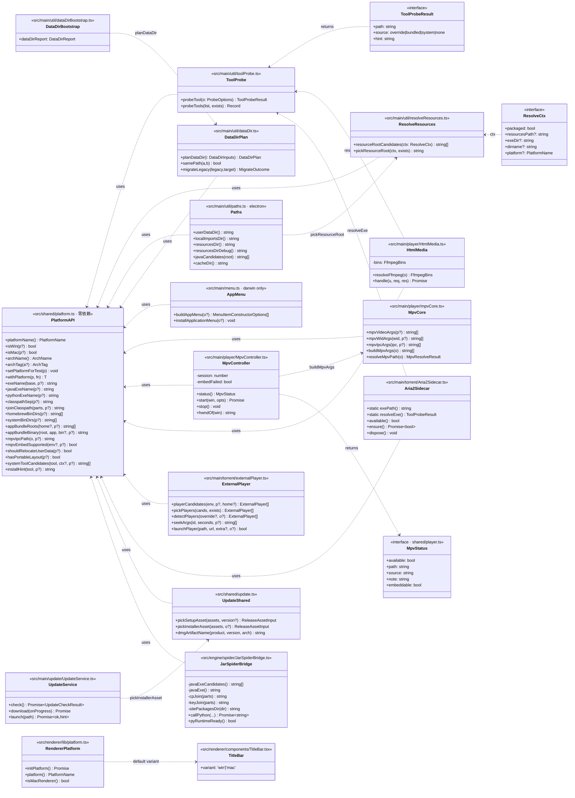
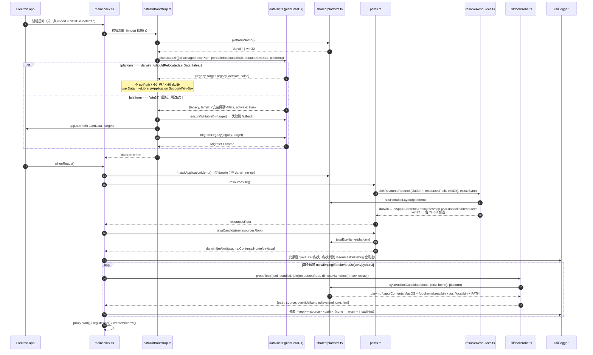
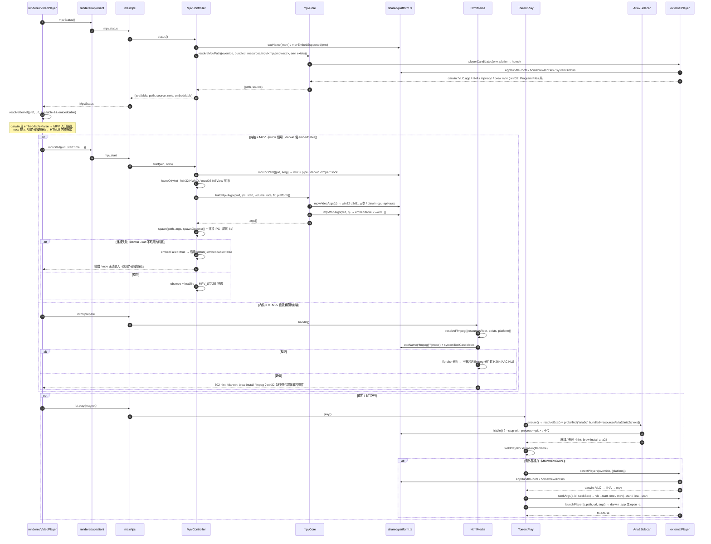
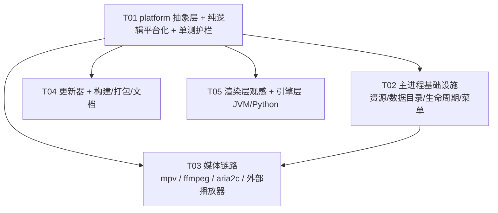

# Win-Box · macOS 适配 —— 系统架构设计与任务分解

| 项 | 内容 |
| --- | --- |
| 文档语言 | 中文 |
| 作者 | 高见远（架构师） |
| 上游输入 | `docs/prd-macos.md`（13×P0 / 13×P1 / 9×P2 / 14 条 UI 差异 / 5 项风险） |
| 仓库根 | `Win-box-main/`（本文所有路径均相对此根） |
| 硬约束 | **Windows 行为零改变、可回归**；所有平台分支以 `process.platform` 归一判定 |
| 本文实现范围 | P0 全 13 项 + P1-1 / P1-2 / P1-4(代码分支) / P1-6 / P1-7 / P1-8 / P1-9 / P1-10 / P1-11 / P1-12；**P2 全不做** |

> **取证说明**：本文所有「现状（文件:行号）」均为我开文件复核后的结果。与 PRD 不一致处以本文为准（差异在对应条目里标注）。

---

## 1. 实现方案概述

### 1.1 核心难点

| # | 难点 | 应对 |
| --- | --- | --- |
| D1 | `process.platform` / `.exe` 后缀 / 路径分隔符散落在 ~20 个文件，改一处漏一处 | 收敛到**单一 platform 出口**，其余文件只调函数不判平台 |
| D2 | macOS 分支无法在 Windows 上真机验证，但必须有单测护栏 | platform 层**支持注入**（`setPlatformForTest` / 可选 `platform` 参数），所有新增纯函数都能在 win32 主机上断言 darwin 行为 |
| D3 | `src/engine/**` 禁止 import electron，且要能在 Vitest（node 环境）跑 | platform 层放 `src/shared/`，**零依赖**（不 import electron / node:fs / node:path），主进程与引擎层共用 |
| D4 | mpv `--wid` 在 macOS（Cocoa `vo=gpu`）是否可用未知（风险 R1） | 能力开关 `mpvEmbedSupported()`：win32 恒 true；darwin 由 env/设置控制（默认 true「先尝试」，可一键关）。关闭时 `MpvStatus.embeddable=false` → 渲染层自动隐藏 MPV 入口，**不阻塞整条链路** |
| D5 | 写进 `.app` 内部会破坏签名密封 | `shouldRelocateUserData()` 平台化：darwin 恒 false，userData 与 imports 都走 `~/Library/Application Support/Win-Box` |
| D6 | 依赖二进制（mpv/ffmpeg/aria2c/java/python3）在 macOS 上仓库里没有 | 统一 `probeTool()` 探测链：**用户覆盖 → 随包内置 → 本机探测（Homebrew/`/usr/local/bin`/PATH/`*.app`）**，缺失时返回人话 `hint`（`brew install <x>`） |

### 1.2 platform 抽象层的落点与共享方式

**落点：`src/shared/platform.ts`（新增，唯一真源）**

选 `src/shared` 而非 `src/main/util` 的三条理由（这也是对 PRD P0-1 中「`src/main/util/platform.ts` / `src/shared/platform.ts`」二选一的定稿）：

1. **引擎层要用**：`src/engine/spider/JarSpiderBridge.ts` 需要 `javaExeName()` / `classpathSep()` / `pythonExeName()` / wheel 平台标签。引擎层 import `src/main/**` 违反既有分层（主进程是 electron 侧，引擎层要能在无 Electron 的 Vitest node 环境跑）。
2. **跨进程共享层要用**：`src/shared/update.ts` 的 `pickInstallerAsset()` 需要 `archTag()` / `platformName()`（它同样零依赖，要被渲染层引用类型）。
3. **渲染层不能直接用**：Vite 打渲染层时 `process.platform` 语义不可靠。所以**渲染层不 import 本模块**，改为「主进程 IPC → preload → 渲染层缓存」（见 §3.14）。

因此 **不创建 `src/main/util/platform.ts`**，避免出现第二个平台真源。三层共享关系：

```
                 src/shared/platform.ts   ← 零依赖、可注入、可单测
                    ↑           ↑                ↑
        src/main/**        src/engine/**    src/shared/update.ts
        (直接 import)      (直接 import)      (直接 import)

src/renderer/** ——— 不 import ———→ 走 IPC: system.platform()
```

### 1.3 可测试性设计（P1-11 的前提）

两条互补机制，**缺一不可**：

1. **可选参数注入**：所有含平台语义的纯函数都接受可选 `platform?: PlatformName`（以及 `arch?`/`home?`/`env?`），**缺省值 = 当前真实平台**。→ Windows 上跑既有测试时缺省值恒为 `win32`，**既有 1569 项断言一行都不用改**（零回归）。
2. **模块级注入**：`setPlatformForTest()` / `withPlatform()` 允许 spec 在作用域内强制切换平台，用于那些「平台不是显式参数」的调用点（如 `MpvController.status()`）。

> 既有 spec 若在任何非 Windows 机器上跑，会因缺省平台变化而失败 —— 这在本次不改（Windows 是主开发机）。但**所有新增/修改的 spec 一律显式传 `platform:'win32'` / `'darwin'`**，保证跨主机确定性。

### 1.4 架构模式

沿用既有分层与「纯函数 + 薄接线」模式（与 `resolveResources.ts` / `dataDir.ts` / `dataDirBootstrap.ts` 同口径）：

- **纯逻辑**（不 import electron，可单测）：`src/shared/platform.ts`、`src/main/util/toolProbe.ts`、`src/main/player/mpvCore.ts`、`src/main/torrent/externalPlayer.ts`（候选表/参数）、`src/shared/update.ts` 资产选择。
- **薄接线**（import electron，只做取值+调用纯函数）：`src/main/util/paths.ts`、`dataDirBootstrap.ts`、`src/main/menu.ts`、`src/main/index.ts`、`MpvController.ts`。

---

## 2. platform 抽象层 API 设计（`src/shared/platform.ts`）

> 全部为**纯函数 / 常量**，不 import `electron`，不 import `node:fs` / `node:path`（路径拼接由调用方 `join()` 完成，或本模块内只用字符串模板 + `/`）。

```ts
// ============================================================
// src/shared/platform.ts —— 平台事实的唯一真源（零依赖，可注入）
// ============================================================

/** 归一后的平台名（只关心这三个；其余归到 'linux'） */
export type PlatformName = 'win32' | 'darwin' | 'linux';

/** 归一后的 CPU 架构 */
export type ArchName = 'arm64' | 'x64' | 'ia32' | 'unknown';

/** dmg/zip 资产名里用的架构标签；未知架构返回 '' （= 不挑架构） */
export type ArchTag = 'arm64' | 'x64' | '';

// ---------- ① 判定（可被测试注入） ----------

/** 当前平台（模块级，可被 setPlatformForTest 覆写） */
export function platformName(): PlatformName;

export function isWin(p?: PlatformName): boolean;
export function isMac(p?: PlatformName): boolean;
export function isLinux(p?: PlatformName): boolean;

/** 当前架构（模块级，可被 setArchForTest 覆写） */
export function archName(): ArchName;
/** dmg/zip 资产后缀：arm64 → 'arm64'，x64 → 'x64'，其余 → '' */
export function archTag(a?: ArchName): ArchTag;

/** ★ 测试注入：置回 null 恢复真实平台 */
export function setPlatformForTest(p: PlatformName | null): void;
export function setArchForTest(a: ArchName | null): void;
/** 作用域内切换平台（finally 自动还原），推荐 spec 用这个 */
export function withPlatform<T>(p: PlatformName, fn: () => T): T;
export function withArch<T>(a: ArchName, fn: () => T): T;

// ---------- ② 可执行文件名与分隔符 ----------

/** 'mpv' → win32 'mpv.exe' / 其余 'mpv'；已带正确后缀时原样返回 */
export function exeName(base: string, p?: PlatformName): string;
export function javaExeName(p?: PlatformName): string;      // 'java.exe' | 'java'
export function pythonExeName(p?: PlatformName): string;    // 'python.exe' | 'python3'

/** classpath 分隔符：win32 ';' / 其余 ':' （★ Unix 必须用 ':'，P1-8/P1-9） */
export function classpathSep(p?: PlatformName): ';' | ':';
export function joinClasspath(parts: string[], p?: PlatformName): string;
/** PATH 环境变量分隔符：win32 ';' / 其余 ':' */
export function envPathSep(p?: PlatformName): ';' | ':';

// ---------- ③ 目录约定 ----------

/** Homebrew 前缀 bin（Apple Silicon 优先）；非 darwin 返回 [] */
export function homebrewBinDirs(p?: PlatformName): string[];
/** 通用系统 bin 目录（darwin: /usr/local/bin + homebrew；win32: []） */
export function systemBinDirs(p?: PlatformName): string[];
/** .app 安装根（darwin: /Applications + ~/Applications；win32: []） */
export function appBundleRoots(home?: string, p?: PlatformName): string[];
/** <root>/<App>.app/Contents/MacOS/<bin> */
export function appBundleBinary(root: string, app: string, bin?: string, p?: PlatformName): string;
/** PATH 拆分（按 envPathSep；win32 另含 Program Files 由 programFilesDirs 负责） */
export function pathBinDirs(env?: Record<string, string | undefined>, p?: PlatformName): string[];

// ---------- ④ 子进程与 IPC ----------

/** spawn 隐藏窗口选项（win32 windowsHide:true；darwin 传 false 亦无害，保持语义） */
export function spawnOptions(p?: PlatformName): { windowsHide: boolean };

export interface MpvIpcOptions { pid: number; seq: number; nonce?: string; tmpDir?: string; }
/**
 * mpv JSON IPC 端点：
 *   win32  → `\\.\pipe\winbox-mpv-<pid>-<seq>-<nonce>`
 *   darwin → `<tmpDir>/winbox-mpv-<pid>-<seq>-<nonce>.sock`   (tmpDir 默认 os.tmpdir())
 */
export function mpvIpcPath(o: MpvIpcOptions, p?: PlatformName): string;

/**
 * ★ 风险 R1 的能力开关：mpv 能否用 --wid 嵌进 Electron 窗口。
 *   win32 恒 true；darwin 默认 true（先尝试），可用环境变量 WINBOX_MAC_MPV_EMBED=0 关闭
 *   （真机验证失败时的总闸，关闭后 macOS 走「仅 HTML5 + 外部播放器」降级路径）。
 */
export function mpvEmbedSupported(
  env?: Record<string, string | undefined>, p?: PlatformName,
): boolean;

// ---------- ⑤ 资源根与数据目录语义 ----------

/** 是否把 userData 搬到「安装目录/data」（win32 true = 现状；darwin false = 绝不写进 .app） */
export function shouldRelocateUserData(p?: PlatformName): boolean;
/** 是否生成 NSIS portable 的 7z-out 候选（仅 win32） */
export function hasPortableLayout(p?: PlatformName): boolean;
/** macOS 打包态 resources 根相对 exe 的位置（exeDir=<App>/Contents/MacOS → ../Resources） */
export function packagedResourcesRel(p?: PlatformName): string[];

// ---------- ⑥ 依赖探测契约 ----------

export type ToolId = 'mpv' | 'ffmpeg' | 'ffprobe' | 'aria2c' | 'java' | 'python3'
                   | 'vlc' | 'iina' | 'potplayer' | 'mpc-hc';

/**
 * 本机探测候选（有序）：darwin 含 .app 内二进制 + Homebrew + /usr/local/bin + PATH；
 * win32 由调用方继续用 Program Files 系（见 externalPlayer.playerCandidates）。
 */
export interface SystemProbeCtx {
  env?: Record<string, string | undefined>;
  home?: string;
  pathDirs?: string[];
}
export function systemToolCandidates(
  tool: ToolId, ctx?: SystemProbeCtx, p?: PlatformName,
): string[];

/** 缺失时的人话修复指引（darwin → `brew install <x>`；win32 → 官网/winget） */
export function installHint(tool: ToolId, p?: PlatformName): string;

/** 探测结果契约（全项目统一，见 §9 共享知识） */
export interface ToolProbeResult {
  path: string;
  source: 'override' | 'bundled' | 'system' | 'none';
  hint: string;
}

// ---------- ⑦ 发布资产 ----------

/** 归一化后的发布平台（用于 pickInstallerAsset） */
export type InstallerPlatform = 'win32' | 'darwin';
export function dmgArtifactName(product: string, version: string, arch: ArchTag): string;
```

### 2.1 配套：`src/main/util/toolProbe.ts`（新增，纯逻辑，不 import electron）

```ts
// src/main/util/toolProbe.ts —— 依赖探测链（用户覆盖 → 随包内置 → 本机探测）
import { platformName, systemToolCandidates, installHint, type ToolId, type ToolProbeResult, type PlatformName } from '../../shared/platform';

export interface ProbeOptions {
  tool: ToolId;
  /** 用户配置覆盖（绝对路径或可执行名） */
  override?: string;
  /** 随包内置绝对路径（resources/<dir>/<exe>）；空 = 不内置 */
  bundled?: string;
  /** 是否允许本机探测（默认 true） */
  allowSystem?: boolean;
  platform?: PlatformName;
  env?: Record<string, string | undefined>;
  home?: string;
  /** 注入，便于单测 */
  exists: (p: string) => boolean;
}

export function probeTool(o: ProbeOptions): ToolProbeResult;

/** 批量：一次探测多个工具，返回 Map<ToolId, ToolProbeResult>（启动日志打点用） */
export function probeTools(list: ProbeOptions[], exists: (p: string) => boolean): Record<string, ToolProbeResult>;
```

**设计要点**：`probeTool` 不 import `node:fs`，`exists` 由调用方注入 → 与 `resolveMpvPath` / `pickPlayers` / `pickResourceRoot` 既有风格一致，零成本单测。

---

## 3. 逐项改造方案（现状 → 目标 → 改法 → 风险）

> 图例：🟢 零 Windows 行为变化（公共路径不改，只新增分支）；🟡 公共签名扩可选参数（缺省值 = 现状）；🔴 需要改公共行为（唯一一处：mpv 的 `MpvStatus` 增字段）

### 3.1 `src/shared/platform.ts`（🟢 新增）

- **现状**：无。全仓 `process.platform` 判定散落在 `index.ts:131/268`、`windowCorner.ts:11`、`jailDrive.ts:114`、`Aria2Sidecar.ts:154`、`externalPlayer.ts` 全表等。
- **目标**：唯一平台真源 + 可注入。
- **改法**：按 §2 全量实现；`platformName()` 内部用 `process.platform` 归一（`darwin`/`win32` 直返，其余归 `linux`）；`archName()` 归一 `process.arch`（`arm64`/`x64`/`ia32`，其余 `unknown`）。
- **风险**：无。`process.platform` 在 node 与 Electron 主进程均可用；渲染层不 import 本模块（见 §3.14）。

### 3.2 `src/main/util/resolveResources.ts`（🟡 P0-2）

- **现状**：`resourceRootCandidates(ctx)`（`:32-73`）打包态候选**全是 Windows 语义**：`:57-61` 的 `7z-out` 三档是 NSIS portable 解压布局专有；darwin 打包态 `process.resourcesPath = <App>/Contents/Resources`，第一条 `join(rp,'app.asar.unpacked','resources')` 恰好能命中，但 `:66-70` 的 exeDir 反推在 darwin 上会生成 `<App>/Contents/MacOS/resources/...` 等无效噪声（不致命，但 debug 日志难读）。
- **目标**：darwin 只出 darwin 候选；`7z-out` 只在 win32 出现。
- **改法**：
  1. `ResolveCtx` 增加可选 `platform?: PlatformName`（缺省 `platformName()`）。
  2. 打包态按平台分支：
     - **win32**：现有逻辑**原样保留**（含 7z-out 全部三档，注释里记的实测证据不动）。
     - **darwin**：
       ```
       join(rp, 'app.asar.unpacked', 'resources')                       // <App>/Contents/Resources/app.asar.unpacked/resources
       join(rp, 'resources')                                            // 备选（若未 asar 化）
       join(exeDir, '..', 'Resources', 'app.asar.unpacked', 'resources')// 由 MacOS/ 反推
       join(exeDir, '..', 'Resources', 'resources')
       join(dirname(exeDir), 'Resources', 'app.asar.unpacked', 'resources')
       ```
     - **linux**：同 darwin 结构（顺带一致）。
  3. 非打包态（dev）分支不动。
- **风险**：低。`pickResourceRoot` 仍返回「第一个存在的候选，全不存在返回首选」，形态不变。需在 `tests/resourcePath.spec.ts` 补 darwin 用例（既有 win32 用例因缺省平台 = win32 不受影响）。

### 3.3 `src/main/util/paths.ts`（🟡 P0-2 / P0-3 / P0-8）

- **现状**：
  - `localImportsDir()`（`:12-17`）打包态取 `dirname(app.getPath('exe'))` → darwin 会落进 `<App>/Contents/MacOS/imports`（**写进 `.app` 内部，破坏签名密封**）。
  - `resourcesDirDebug()`（`:96`）硬编码 `join(c,'jvm','jre','bin','java.exe')` → darwin 上标记恒为 `[? ]`。
- **目标**：darwin 下 imports 进 userData；debug 探针按平台取 java 名，并兼容 `jre/Contents/Home/bin/java`。
- **改法**：
  1. `localImportsDir()`：`if (isMac()) return join(app.getPath('userData'), 'imports');`，win32 分支原样。
  2. 新增导出 `javaCandidates(root: string): string[]`（win32 `[root/jvm/jre/bin/java.exe]`；darwin `[root/jvm/jre/bin/java, root/jvm/jre/Contents/Home/bin/java]`），`resourcesDirDebug()` 用它判定 `[OK]`。
  3. `ctx()` 增加 `platform: platformName()` 传给 `pickResourceRoot`。
- **风险**：低。`localImportsDir()` 被 `LocalPkgStore` 使用，darwin 上是新目录（无历史数据），无迁移问题。

### 3.4 `src/main/util/dataDir.ts` + `dataDirBootstrap.ts`（🟡 P0-8）

- **现状**：`planDataDir()`（`:43-49`）打包态恒把 userData 搬到 `dirname(exePath)/data`；`dataDirBootstrap.ts:26-75` 无条件执行搬迁 + 迁移。`samePath()`（`:52`）用 `toLowerCase()` 比较（Windows 大小写不敏感假设）。
- **目标**：darwin **不搬运**（userData = `~/Library/Application Support/Win-Box`，即 electron-builder 默认），`activate=false`，`mode='dev'` 语义沿用（表示「未启用搬迁」）。
- **改法**：
  1. `DataDirInputs` 增加 `platform?: PlatformName`（缺省 `platformName()`）。
  2. `planDataDir()` 开头加：
     ```ts
     if (!shouldRelocateUserData(i.platform)) return { legacy, target: legacy, activate: false };
     ```
     → win32 完全不变；darwin 直接短路，**不会 `app.setPath`、不会迁移、不会删旧目录**。
  3. `samePath()` 增加注释：macOS 默认卷（APFS）大小写不敏感，但用户可格式化为大小写敏感卷 → 保留 `toLowerCase()`（更宽松，只会更保守地把两路径判为相同 → 不搬迁，安全方向正确）。
  4. `dataDirBootstrap.ts` 透传 `platform`；`DataDirReport.mode` 的 `'dev'` 文案在渲染层按平台中性化（见 §3.15）。
- **风险**：中（R5）。护栏：`tests/dataDir.spec.ts` 新增断言「darwin 下 `planDataDir().activate === false` 且 `target === legacy`」+「darwin 下 target 不含 `.app`」。`tests/appCacheDir.spec.ts` 同理（cacheDir 基于 userData，自动正确）。

### 3.5 `src/main/index.ts`（🟡 P0-3 / P0-10 / P0-13）

| 子项 | 现状 | 改法 | 风险 |
| --- | --- | --- | --- |
| mica | `:131` 已 `...(process.platform==='win32' ? {backgroundMaterial:'mica'} : {})` | **不动**（已正确）。darwin 不加 `vibrancy`（播放器窗是透明窗，vibrancy 会盖住 mpv 画面） | 无 |
| JRE 校验 | `:200` `existsSync(join(dir,'jvm','jre','bin','java.exe'))`；`:201` 日志写 `java.exe: OK/缺失` | 改用 `javaCandidates()`（§3.3）；日志文案改 `java: OK/缺失`；`:202` 的 `resourcesDirDebug()` 自动带 darwin 候选 | 无 |
| 窗口全关 | `:266-269` `proxy.stop()` **对所有平台执行**，再 `if (process.platform!=='darwin') app.quit()` | 改为：<br>`if (isMac()) return;`<br>`proxy.stop(); app.quit();`<br>→ darwin 关完窗口**保留代理 + Dock 常驻** | 低。Windows 分支逻辑完全不变 |
| activate | `:261-263` 只在无窗口时 `createWindow()` | darwin 分支补充：`if (BrowserWindow.getAllWindows().length === 0) createWindow(); else 聚焦首个可见窗口`。老板键隐藏态不动（`mainWindow` 仍非 null） | 低 |
| will-quit | `:274-308` 清理链（quark/JVM/torrent/proxy） | **不动**，darwin 上同样生效（`Cmd+Q` → `will-quit`）。`torrent.dispose()`/mpv dispose 已覆盖 | 无 |
| 单实例 | `:315-326` | 不动。darwin 的 `open-file`/`open-url` 属 P2，本次不做 | 无 |
| 应用菜单 | 无 | `whenReady()` 内 darwin 调 `installApplicationMenu()`（§3.11） | 低 |
| 启动日志 | `:197-205` | 追加一行依赖探测总览（mpv/ffmpeg/aria2c/java/python3 各一行 `tool: <source> <path>`，见 §3.6） | 无 |

### 3.6 `src/main/util/toolProbe.ts`（🟢 新增）+ 启动探测日志

- **现状**：无统一探测；`mpvCore.resolveMpvPath` 自己探；`HtmlMedia`/`Aria2Sidecar` 只看随包内置路径。
- **目标**：G4「依赖可观测」—— 启动日志一行一个依赖；配置页可见来源。
- **改法**：`toolProbe.ts` 实现 §2.1；`index.ts` `whenReady()` 里对 `mpv / ffmpeg / ffprobe / aria2c / java / python3` 各跑一次 `probeTool({ bundled: join(resourcesDir(), dir, exeName(x)), exists: existsSync })`，`fileLogger.i`/`w` 输出 `依赖: mpv=system /opt/homebrew/bin/mpv`。并新增 IPC `system.deps`（配置页展示，可选——本次**只落日志+note 上屏**，配置页表格属 P2 精简，不新增 IPC）。
- **风险**：低。探测只做 `existsSync`，无 IO 开销。

### 3.7 `src/main/player/mpvCore.ts`（🟡 P0-4）

- **现状**：
  - `buildMpvArgs()`（`:216-243`）硬编码 `--vo=gpu --gpu-api=d3d11 --gpu-context=d3d11 --d3d11-feature-level=11_0`（`:224-227`）、`--wid=${o.wid}`（`:232`）、`--input-ipc-server=${o.pipe}`（`:233`）。
  - `resolveMpvPath()`（`:295-312`）内部 `playerCandidates(env).filter(id==='mpv')` — 只要 §3.10 让候选表平台化，darwin 探测自动生效。
- **目标**：参数与 IPC 端点按平台生成；`--wid` 能力可关。
- **改法**：
  1. `BuildMpvArgsOptions` 增加 `platform?: PlatformName`、`ipc?: string`（不变动既有 `pipe` 字段语义，保留 `pipe`）。
  2. 抽出纯函数（便于单测）：
     ```ts
     export function mpvVideoArgs(p?: PlatformName): string[];
     //   win32 : ['--vo=gpu','--gpu-api=d3d11','--gpu-context=d3d11','--d3d11-feature-level=11_0','--hwdec=auto-safe']
     //   darwin: ['--vo=gpu','--gpu-api=auto','--gpu-context=auto','--hwdec=auto-safe']
     //   ★ darwin 保留 auto-safe（它在 macOS 上会自动选中 videotoolbox）；
     //     如需强制硬解，由环境变量 WINBOX_MPV_HWDEC=videotoolbox 覆盖，默认不动。
     export function mpvWidArgs(wid: string, p?: PlatformName): string[];
     //   mpvEmbedSupported() ? [`--wid=${wid}`] : []
     export function mpvIpcArgs(ipc: string, p?: PlatformName): string[];  // [`--input-ipc-server=${ipc}`]
     ```
  3. `buildMpvArgs()` 改为调用上述三个函数；win32 缺省下产出的数组与**现有顺序/内容逐项一致**（`tests/mpvCore.spec.ts` 既有断言不动）。
  4. `resolveMpvPath` 的 `bundled` 由调用方（`MpvController.status()`）用 `exeName('mpv')` 拼（§3.8），本文件不改。
  5. 新增 `mpvEmbedSupported()` 从 `src/shared/platform` re-export（供 mpvCore 单测就近 import）。
- **风险**：**高（R1）**。缓解：darwin 的 `--wid` 由 `mpvEmbedSupported()` 控制；`MpvController.startInternal` 里若 spawn 后 `CONNECT_TIMEOUT_MS` 内未连上 IPC，记 `fileLogger.w` 并把 `embedFailed` 置位（进程内一次性），`status().embeddable` 随之转 false，渲染层下次不再显示 MPV 入口。**失败不影响 HTML5 内核**。

### 3.8 `src/main/player/MpvController.ts`（🟡 P0-4）

- **现状**：`hwndOf(win)`（`:38-46`，`readBigUInt64LE`）；`status()` `:73` `join(resourcesDir(),'mpv','mpv.exe')`；`:87` note 写「可在配置页指定 mpv.exe 路径」；`:131` `pipe = '\\\\.\\pipe\\winbox-mpv-...'`；`:141` `spawn(st.path, args, { windowsHide: true, ... })`；`:173-188` `updateViewport`（`video-margin-ratio-top`）。
- **目标**：darwin 用 unix socket + 去 `.exe` + 去 `windowsHide` 语义；`--wid` 不可用时优雅降级。
- **改法**：
  1. `hwndOf` 保留（darwin 的 `getNativeWindowHandle()` 同样返回 Buffer，取值逻辑一致），新增别名导出 `nativeWindowIdOf = hwndOf`，注释改为「取原生窗口句柄（win32=HWND / macOS=NSView 指针）」。
  2. `status()`：
     ```ts
     const bundled = join(resourcesDir(), 'mpv', exeName('mpv'));
     const embeddable = mpvEmbedSupported(process.env);
     const note = ... (darwin & !embeddable ? '当前平台不支持内嵌 mpv，请使用外部播放器' : 既有人话)
     return { available, path, source, note, embeddable };
     ```
     > `MpvStatus`（`src/shared/player.ts:77-83`）**新增必填字段 `embeddable: boolean`** —— 唯一一处 🔴。win32 恒 `true`，`VideoPlayer.tsx:512` 改为 `resolveKernel(kernelPref, url, !!(mpvInfo?.available && mpvInfo.embeddable))` → Windows 行为零变化。
  3. `:131` 管道 → `const ipc = mpvIpcPath({ pid: process.pid, seq: ++this.pipeSeq, nonce: Date.now().toString(36) });`；darwin 分支在 spawn 前 `rmSync(ipc, { force: true })` 清理陈旧 socket 文件（防止上次崩溃残留导致 connect 失败）。
  4. `:141` spawn 选项 → `{ ...spawnOptions(), stdio: ['ignore','pipe','pipe'] }`。
  5. `:130` `if (!hwnd) throw` → 改为：`const wid = hwndOf(win); if (mpvEmbedSupported() && !wid) throw ...`（不可嵌入时不需要 wid）。
  6. `startInternal` 的 IPC 连接失败 → 记 warn 并置 `this.embedFailed = true`（见 §3.7 风险缓解）。
  7. `updateViewport`（`:173-188`）不动（darwin 同样用 `video-margin-ratio-top`；全屏/小窗高度常量 0/18/38 与平台无关）。
- **风险**：中（R1 + socket 残留）。护栏：`tests/mpvControllerLifecycle.spec.ts` 补「darwin 下 `mpvIpcPath` 以 `<tmp>/` 开头且以 `.sock` 结尾」。

### 3.9 `src/main/player/HtmlMedia.ts`（🟡 P0-5）

- **现状**：`:156` `join(resourcesDir(),'ffmpeg','ffprobe.exe')`、`:157` `ffmpeg.exe`、`:158` `if (!existsSync(ffprobe)||!existsSync(ffmpeg)) throw new Error('缺少随包媒体兼容组件')`；`:197` 分片转码再次 `ffmpeg.exe`。仓库 `resources/ffmpeg/` 只有 `README.txt`（`.gitignore` 排除 `*.exe`）。
- **目标**：darwin 主路径 = 本机探测（Homebrew/PATH），回退随包内置；缺失给 `brew install ffmpeg` 人话。
- **改法**：
  1. 新增导出纯函数（可单测）：
     ```ts
     export interface FfmpegBins { ffmpeg: string; ffprobe: string; missing: string[]; hint: string; }
     export function resolveFfmpeg(o: { resourcesRoot: string; override?: string;
       platform?: PlatformName; env?; exists: (p:string)=>boolean }): FfmpegBins;
     ```
     → 内部对 `ffmpeg`/`ffprobe` 各调一次 `probeTool({ tool, bundled: join(resourcesRoot,'ffmpeg', exeName(name)), exists })`。
  2. `:156-158` 改为：`const bins = resolveFfmpeg({ resourcesRoot: resourcesDir(), exists: existsSync }); if (bins.missing.length) throw new Error(bins.hint);`
     - darwin hint：`未找到 ffmpeg/ffprobe。请执行 brew install ffmpeg，或在配置页指定路径。`
     - win32 hint 保持 `缺少随包媒体兼容组件`（既有文案，零回归）。
  3. `:197` 改用 `bins.ffmpeg`。
  4. 建议把解析结果**缓存在实例字段**（`this.bins`），避免每分片重复探测。
- **风险**：低。既有 `tests/htmlMedia.spec.ts` 若断言过 `缺少随包媒体兼容组件` 文案，win32 缺省下不变。

### 3.10 `src/main/torrent/externalPlayer.ts`（🟡 P0-7 / P1 外部播放器）

- **现状**：`playerCandidates(env)`（`:24-51`）**整表是 Windows 路径**（Program Files / DAUM / VideoLAN / mpv.net / K-Lite），darwin 上 `detectPlayers()` 恒空 → 磁力与点播外部接力全断。`seekArgs()`（`:99-110`）已支持 `vlc → --start-time` / `mpv → --start`，**缺 IINA**。`launchPlayer()`（`:117-126`）直接 `spawn(path)`，对 `.app` 目录不适用。
- **目标**：darwin 候选覆盖 VLC / IINA / mpv（`/Applications` + `~/Applications` + Homebrew）；`seekArgs` 补 IINA；`launchPlayer` 支持 `.app`。
- **改法**：
  1. `playerCandidates(env, p = platformName(), home = os.homedir?.() ?? env.HOME ?? '')`：
     - **win32 分支**：现有 15 条候选**原样保留**（顺序不动，零回归）。
     - **darwin 分支**（顺序即优先级）：
       ```
       vlc : /Applications/VLC.app/Contents/MacOS/VLC
       vlc : ~/Applications/VLC.app/Contents/MacOS/VLC
       iina: /Applications/IINA.app/Contents/MacOS/IINA
       iina: ~/Applications/IINA.app/Contents/MacOS/IINA
       mpv : /Applications/mpv.app/Contents/MacOS/mpv
       mpv : ~/Applications/mpv.app/Contents/MacOS/mpv
       mpv : /opt/homebrew/bin/mpv
       mpv : /usr/local/bin/mpv
       ```
       （用 `appBundleBinary(root, app, bin, p)` 生成；`mpv` id 与 win32 一致，`seekArgs('mpv')` 自动生效）
  2. `seekArgs(id, seconds, p?)`：新增 `if (id === 'iina') return ['--start=' + s];`（IINA 基于 mpv 内核，参数同 mpv）。既有 potplayer/vlc/mpv 分支不动。
  3. `launchPlayer(path, url, extraArgs, opts?: { platform?: PlatformName })`：darwin 且 `path.endsWith('.app')` → `spawn('open', ['-a', path, '--args', ...extraArgs, url], { detached: true, stdio: 'ignore' })`；否则保持 `spawn(path, [...extraArgs, url])`。
  4. `detectPlayers(overridePath, opts?)` 增加可选平台透传（缺省当前平台）。
- **风险**：低。`pickPlayers` / `detectPlayers` 的覆盖语义不变。

### 3.11 `src/main/torrent/Aria2Sidecar.ts` + `torrentPlay.ts`（🟡 P0-6）

- **现状**：`Aria2Sidecar.exePath()`（`:120`）`join(resourcesDir(),'aria2','aria2c.exe')`；`:154` `process.platform === 'win32' ? process.pid : undefined`（**已经只 win32 传 `--stop-with-process`，PRD 说的「需改」其实已正确** —— 复核结论）；`torrentPlay.ts:183` 文案里拼 `Aria2Sidecar.exePath()`；`torrentPlay.ts:266/:269` 文案写死「PotPlayer / VLC / mpv / MPC-HC」。
- **目标**：darwin 二进制名去 `.exe`；允许 Homebrew 兜底探测；文案平台中性。
- **改法**：
  1. `exePath()` → `join(resourcesDir(),'aria2', exeName('aria2c'))`。
  2. 新增 `static resolveExe(): ToolProbeResult`（`probeTool({ tool:'aria2c', bundled: exePath(), exists: existsSync })`），`available()`/`start()` 改用它的 `path`；缺失 hint：`未内置 BT 引擎且本机未安装 aria2c（brew install aria2）`。
  3. `:154` 的 `process.platform === 'win32'` 换成 `isWin()`（行为不变，收敛到 platform 层）。
  4. `dispose()`：darwin 无 `--stop-with-process`，`proc.kill()` 已足够；补 `proc.kill('SIGKILL')` 兜底（1.5s 后仍存活时）。
  5. `torrentPlay.ts:269` 文案 → `未检测到外部播放器（${isMac() ? '可安装 VLC / IINA / mpv' : '可安装 PotPlayer / VLC / mpv / MPC-HC'}）`；`:183` 用 `resolveExe().path`。
- **风险**：低。aria2c 是**唯一随包内置**的依赖（决策 7），构建时需自备 `resources/aria2/aria2c`（macOS 版）。

### 3.12 `src/shared/update.ts` + `src/main/update/UpdateService.ts` + `scripts/upload-release.mjs`（🟡 P0-9 / P1-12）

- **现状**：`pickSetupAsset()`（`update.ts:302-315`）只 `/\.exe$/i` 过滤，`.dmg` 恒返回 null → darwin 上强制更新**永不触发**（等价于"有新版也不更新"）。`UpdateService.ts:99` 日志写「未找到 .exe 安装包」；`launch()`（`:403-410`）`shell.openPath()` 后只记一条日志。`upload-release.mjs:33-39` 只挑 `.exe` 且文件名必须等于 `Win-Box Setup <v>.exe` / `Win-Box <v>.exe`。
- **目标**：darwin 按 `process.arch` 挑 dmg → 任意 dmg → zip；`launch()` 返回引导文案；上传脚本支持 dmg。
- **改法**：
  1. `src/shared/update.ts` 新增（**不动 `pickSetupAsset` 的实现**，改为委托）：
     ```ts
     export interface PickInstallerOptions {
       platform?: InstallerPlatform;   // 缺省 'win32'
       arch?: ArchTag;                 // 缺省 archTag()
       version?: string;
     }
     export function pickInstallerAsset(assets: ReleaseAssetInput[], o?: PickInstallerOptions): ReleaseAssetInput | null;

     /** 兼容旧签名：= pickInstallerAsset(assets, { platform:'win32', version }) —— 既有断言全部保持 */
     export function pickSetupAsset(assets: ReleaseAssetInput[], version?: string): ReleaseAssetInput | null;
     ```
     darwin 选择顺序（严格按此实现并可单测）：
     ```
     ① .dmg 且名字含 `-<arch>`（arm64 / x64；arch='' 时跳过本档）
     ② .dmg 且名字含目标 version
     ③ 任意 .dmg
     ④ 任意 .zip（darwin 便携包兜底）
     ```
  2. `UpdateService.check()`：`pickInstallerAsset(rel.assets, { platform: platformName(), arch: archTag(), version: rel.version })`；`:99` 日志文案 → `未找到安装包（platform=<p> arch=<a>），跳过强制更新`。
  3. `UpdateService.launch(path)` 返回值加 `hint?`：darwin → `已打开安装包（.dmg）。请将 Win-Box 拖入「应用程序」文件夹覆盖安装。`；win32 → `''`（既有行为）。渲染层更新弹窗在有 hint 时追加一行提示。
  4. `upload-release.mjs`：资产筛选增加 `|| e.name.toLowerCase().endsWith('.dmg')`，并接受 `Win-Box-<version>-arm64.dmg` / `-x64.dmg` 命名；打印 `Installer:` 时区分平台。Windows 分支逻辑不动。
- **风险**：低-中。护栏：`tests/update.spec.ts` 新增 darwin 用例（arm64 优先、回退任意 dmg、回退 zip、全无 → null），既有 win32 用例不动。

### 3.13 `src/main/menu.ts`（🟢 新增，P1-1）

- **现状**：所有窗口 `frame:false` + `autoHideMenuBar:true`，**全应用零菜单** → Mac 上拿不到 `Cmd+Q`/`Cmd+W`/`Cmd+,`/复制粘贴（系统仍会响应部分编辑键，但没有 Edit 菜单、没有「退出 Win-Box」）。
- **目标**：darwin 注册应用菜单（§4.1 表）。
- **改法**：
  ```ts
  export interface AppMenuOptions {
    version?: string;
    onAbout?: () => void;        // 打开「说明」页（发 IPC ui:gotoAbout）
    onPreferences?: () => void;  // Cmd+, → 发 IPC ui:gotoSettings
  }
  export function buildAppMenu(o?: AppMenuOptions): Electron.MenuItemConstructorOptions[];
  export function installApplicationMenu(o?: AppMenuOptions): void;  // 非 darwin 直接 return（no-op）
  ```
  菜单结构（全部用 Electron `role`，不自己实现行为）：
  - **App（productName）**：`about`（绑定 `onAbout`）、`---`、`services`、`---`、`hide`/`hideOthers`/`unhide`、`---`、`quit`（`Cmd+Q`）
  - **编辑**：`undo`/`redo`/`---`/`cut`/`copy`/`paste`/`pasteAndMatchStyle`/`delete`/`selectAll`
  - **窗口**：`minimize`/`zoom`/`---`/`close`（`Cmd+W`）/`---`/`front`
  - **帮助**：打开 Release 页（`shell.openExternal(UPDATE_RELEASES_PAGE)`）
  - `onPreferences` 用 `role: 'preferences'` + `accelerator: 'CmdOrCtrl+,'` 的 click 钩子（非 darwin 不注册，零 Windows 影响）。
- **风险**：低。`installApplicationMenu` 在非 darwin 是 no-op，Windows 完全无感。需真机验证：`Cmd+W` 关窗口后应用仍在 Dock。

### 3.14 渲染层平台感知（🟢 新增，P1-2 的前提）

- **现状**：`src/renderer` 无法知道平台；`TitleBar.tsx:30` 默认 `variant='win'`，`variant='mac'` 只在 `App.tsx:546`（Apple 皮肤工具栏）用。
- **目标**：darwin 下所有窗口 TitleBar 默认走 `mac` 变体；配置页文案平台化。
- **改法**：
  1. `src/main/ipc/index.ts` 新增 `registerHandler(IPC.SYSTEM_PLATFORM, () => platformName())`（`src/shared/ipc-channels.ts` 加常量 `SYSTEM_PLATFORM = 'system:platform'`）。
  2. `src/main/preload.ts`：`system: { ..., platform: () => invoke<PlatformName>(IPC.SYSTEM_PLATFORM) }`。
  3. `src/renderer/api/client.ts`：`platform: () => unwrap(window.api.system.platform())`，并在 `api` 类型声明里补上。
  4. **新增 `src/renderer/lib/platform.ts`**：
     ```ts
     let cached: PlatformName | null = null;
     export async function initPlatform(): Promise<void>;  // main.tsx 启动时 await 一次
     export function platform(): PlatformName;             // 未 init 时返回 'win32'（安全默认）
     export function isMacRenderer(): boolean;
     ```
  5. `src/renderer/main.tsx`：`await initPlatform()` 后再 render（或 `void initPlatform()` + TitleBar 首次渲染兜底为 win 变体，darwin 下有一帧闪烁 → **建议 await**，启动阶段多一次 IPC 无感）。
- **风险**：低。Windows 上 `initPlatform()` 返回 `win32`，一切照旧。

### 3.15 `src/renderer/components/TitleBar.tsx` + `PlayerPage.tsx`（🟡 P1-2）

- **现状**：`variant` 默认 `'win'`；`mac` 变体（`:41-64`）渲染左置红黄绿三点（关/最小/缩放），**双击标题栏 = `toggleMax()`（Windows maximize 语义）**，且不渲染 `showMini` / `showPin` 按钮（播放器窗口的「小窗口」「置顶」在 mac 变体下**没有位置**）。
- **目标**：darwin 下默认 `mac` 变体；缩放按钮走 macOS `zoom` 语义（复用既有 `client.winMaximize()`，Electron 在 darwin 上 `maximize()` 即 zoom，语义一致）；**播放器窗口的「小窗口/置顶」在 mac 变体下补回**（放在交通灯右侧，不挤占灯区）。
- **改法**：
  1. `TitleBar.tsx:30` 默认参数改为 `variant = isMacRenderer() ? 'mac' : 'win'`。
  2. `mac` 分支的 JSX 增加：交通灯 `<div class="ap-lights">` 之后追加一个 `<div class="ap-extra">`（no-drag），当 `showMini || showPin` 时渲染对应的小图标按钮（复用 `win` 分支里已有的 SVG/样式类 `tb-btn tb-pin` / mini 图标，只是容器不同）。
  3. 双击标题栏：darwin 保持 `toggleMax()`（注释说明 macOS zoom 语义）；不新增 API。
  4. `PlayerPage.tsx:356` 的 `<TitleBar ...>` 不再硬编码变体（交给默认值）。
- **风险**：低。Windows 上 `isMacRenderer()` 恒 false，`variant` 默认值仍是 `'win'`，且显式传值的调用点（`App.tsx:546` 的 `'mac'`）优先级更高。
- **⚠️ 待真机验证**：mac 变体下交通灯位置/间距与播放器控制条是否重叠；「关闭」在 darwin 只关窗口不退出（已由 §3.5 保证）。

### 3.16 `src/renderer/pages/ConfigPage.tsx` + `AboutPage.tsx`（🟡 P1-7 / 文案中性化）

- **现状**（复核到的 9 处 Windows 文案，比 PRD 列的 6 处多 3 处）：
  `:154`、`:204` 「可安装 PotPlayer / VLC / mpv / MPC-HC，或手动粘贴播放器 exe 路径」
  `:166` 「恢复自动检测（PotPlayer → VLC → mpv → MPC-HC）」
  `:191` 「请点「检测」选择本机播放器，或粘贴 exe 路径后点「保存」」
  `:1490` 「Windows 设置 → 辅助功能 → 视觉效果」
  `:1568`、`:1612` placeholder「播放器 exe 路径（…）」
  `:1596` 「点播外部播放器（PotPlayer 等）」
  `:1654` placeholder「mpv.exe 路径覆盖（留空 = 用随包内置构建）…」
- **目标**：darwin 下改为平台中性/本机示例；win32 一字不改。
- **改法**：在组件内取 `const mac = isMacRenderer();`，按下表切换：

| 行 | win32（保持现状） | darwin |
| --- | --- | --- |
| 154/204 | …PotPlayer / VLC / mpv / MPC-HC…粘贴播放器 exe 路径 | …VLC / IINA / mpv…粘贴播放器路径（如 `/Applications/VLC.app/Contents/MacOS/VLC`） |
| 166 | 恢复自动检测（PotPlayer → VLC → mpv → MPC-HC） | 恢复自动检测（VLC → IINA → mpv） |
| 191 | …或粘贴 exe 路径后点「保存」 | …或粘贴播放器路径后点「保存」 |
| 1490 | Windows 设置 → 辅助功能 → 视觉效果 | 系统设置 → 辅助功能 → 显示（减少动态效果） |
| 1568/1612 | 播放器 exe 路径（…） | 播放器路径（…） |
| 1596 | 点播外部播放器（PotPlayer 等） | 点播外部播放器（VLC / IINA 等） |
| 1654 | mpv.exe 路径覆盖（…） | mpv 路径覆盖（…） |

- `AboutPage.tsx`：darwin 下追加一节「首次打开被系统拦截怎么办」（右键「打开」→ 系统设置 → 隐私与安全性 → 仍要打开），并链到 `docs/macos-build.md` 的对应章节（P1-7）。
- **风险**：低。

### 3.17 `src/renderer/styles/*.css`（🟡 P1-6 字体栈）

- **现状**：`global.css:50` `font: 14px/1.55 -apple-system, "Segoe UI", "Microsoft YaHei", "PingFang SC", system-ui, sans-serif;` —— **PingFang SC 排在微软雅黑之后**，Retina 下中文会先命中雅黑（若系统装有）导致字形偏细/不一致。`netflix.css:47` 完全没有 PingFang SC。`apple.css:52` / `bilibili.css:41` 已有 PingFang SC（无需改）。
- **目标**：darwin 优先 `-apple-system → BlinkMacSystemFont → PingFang SC → Helvetica Neue → 微软雅黑/雅黑回退`。
- **改法**：
  1. `global.css:50` → `-apple-system, BlinkMacSystemFont, "PingFang SC", "Helvetica Neue", "Microsoft YaHei", "Segoe UI", system-ui, sans-serif`（**在 Windows 上无 PingFang SC / Helvetica Neue，自动落到雅黑，视觉零变化**）。
  2. `netflix.css:47` 在 `"Helvetica Neue"` 后插入 `"PingFang SC"`。
  3. `global.css:653` 字幕 `font-family: 'Microsoft YaHei','PingFang SC'` → 调换为 `'PingFang SC','Microsoft YaHei'`。
  4. 不新增 CSS 文件、不改 4 套主题的其他变量（避免观感漂移）。
- **风险**：低。⚠️ 待真机验证：Retina 下 4 套主题的字重/对比度。

### 3.18 `src/engine/spider/JarSpiderBridge.ts`（🟡 P1-8 / P1-9）

- **现状**（复核后完整清单）：
  - JVM：`:427-428 javaExePath()` = `join(jvmDir,'jre','bin','java.exe')`；`:431-441 javaExe()` 存在性探针同路径。
  - classpath（**真实传给 `-cp` / `-D` 的**，必须用 `:`）：`:449 classpathJars()`、`:714 d2j cp`、`:1131 runtimeCp`、`:1134 loadCp`、`:1384 runtimeCp`、`:1390 loadCp`、`:2001 -Dtvbox.d2j.cp`。
  - **缓存 key**（`:1125`、`:1298`、`:1319`、`:1370` 的 `jarPaths.join(';')`）—— **不是 classpath，保持 `;` 不动**（改了会让所有缓存 key 漂移，且跨平台无意义）。
  - Python：`:1154`、`:1484`、`:1644` `join(dir,'python.exe')`；`:1182-1184` 就绪判定含 `Lib/site-packages`；`:1574-1576 PYTHON_EMBED_URLS` 全是 `python-3.x-embed-amd64.zip`（Windows 专有）；`:1589-1610 PY_WHEELS` 二进制 wheel 标签全是 `win_amd64`/`cp311`；`:1808`/`:1848` `join(dir,'Lib','site-packages')`；`:1632` 探测 `python.exe`。
- **目标**：darwin 下 java/python3 名称正确、classpath 用 `:`、site-packages 路径正确、wheel 标签用 `macosx_*`；缺失时给 `PY_UNSUPPORTED` 人话降级（既有语义）。
- **改法**：
  1. 新增私有：`private cpJoin(parts: string[]): string { return joinClasspath(parts); }` 与 `private keyJoin(parts: string[]): string { return parts.join(';'); }`，按上表替换（**key 类调用点注释标明「缓存键，非 classpath，勿改分隔符」**）。
  2. `javaExePath()` → `join(jvmDir,'jre','bin', javaExeName())`；新增
     ```ts
     private javaExeCandidates(): string[]
     //  win32 : [jvm/jre/bin/java.exe]
     //  darwin: [jvm/jre/bin/java, jvm/jre/Contents/Home/bin/java]  ← macOS jlink 镜像常见布局
     ```
     `javaExe()` 改为「返回第一个存在的候选；都不存在才抛错」，错误信息的 `probe` 段落列出全部候选（保持既有排障信息量）。`:334`/`:2035` 的 `spec.exe === this.javaExePath()` 判定改用 `javaExeCandidates().includes(spec.exe)`。
  3. Python：
     - `pythonExeName()` 替换全部 `python.exe` 字面量（`:1154`/`:1484`/`:1632`/`:1644`/`:1182`）。
     - 新增 `private sitePackagesDir(dir: string): string`：win32 `join(dir,'Lib','site-packages')`；darwin `join(dir,'lib', `python${PY_VER_MAJOR_MINOR}`, 'site-packages')`。
     - `PYTHON_EMBED_URLS` 只用于 win32；darwin 走**本机探测**：`probeTool({ tool:'python3', allowSystem:true })`（`/opt/homebrew/bin/python3` → `/usr/local/bin/python3` → `/usr/bin/python3` → PATH）；`ensurePythonRuntime()` 在 darwin 上直接返回系统 python3 根，跳过 11MB embed 下载。
     - `PY_WHEELS` 为每个**二进制** wheel 增加可选 `darwin?: string`（如 `lxml` → `macosx_11_0_arm64`/`macosx_10_9_x86_64`，`Pillow` 同理），取值时按 `platformName()` 选标签；纯 py wheel（`py3-none-any`）不变。
     - 缺失时抛出的错误文案（`:1673`）按平台给指引（darwin：`brew install python3 && pip3 install --user <pkg>`）。
- **风险**：**中（R4）**。JVMPython 蜘蛛在 macOS 上的完整可用性需真机验证；不可用的壳/py 源走既有 `PY_UNSUPPORTED` 人话降级，**不作为 P0 阻塞**。护栏：`tests/jvmSpawnArgs.spec.ts` / `tests/pythonRuntime.spec.ts` 补 darwin 断言（`-cp` 用 `:`、exe 名无 `.exe`、site-packages 路径）。

### 3.19 构建与发布（🟢 P0-11 / P0-12 / P1-10 / P1-12）

| 文件 | 现状 | 改法 |
| --- | --- | --- |
| `package.json` `build` | 只有 `win.icon/target:["nsis"]` + `nsis.*`；`appId: com.winbox.win`、productName `Win-Box`（**沿用不改**，决策 5） | 新增 `mac` 段（见下方 JSON）与 `dmg` 段；新增 scripts `dist:mac`；`win` 段**一字不动** |
| `package.json` `scripts` | `dist: node scripts/build-release.mjs` | 新增 `"dist:mac": "node scripts/build-release.mjs --mac"`；`dist` 保持默认 Windows（零回归） |
| `scripts/build-release.mjs` | `:37` 硬编码 `['...cli.js','--win','nsis','--publish','never']` | 解析 argv：`--mac` → `['--mac','dmg','zip','--publish','never']`；`--win`/缺省 → 原样。**不删 `--win` 分支**，PowerShell 脚本（`pack-*.ps1`）原样保留 |
| `scripts/upload-release.mjs` | 只挑 `.exe` | 见 §3.12-4 |
| `build/icon.icns` | 无（`build/icons/` 只有 16/24/32/48/64/128/256 PNG；无 512/1024） | 新增 `scripts/make-icon.mjs`：**仅 macOS 可跑**，用系统自带 `sips` 把 256 放大生成 512/1024，拼 `build/icon.iconset/`（16/32/64/128/256/512/1024 及其 @2x），再 `iconutil -c icns`。产物 `build/icon.icns`（建议入 git，避免 Mac 外无法构建） |
| `build/entitlements.mac.plist` | 无 | 新增占位（见下） |
| `build/entitlements.mac.inherit.plist` | 无 | 新增占位 |
| `docs/macos-build.md` | 无 | 新增（见 §3.20） |
| `README.md` | 「发布附件」只讲 `.exe` | 补 dmg 与架构命名说明 |

`package.json` 新增段：

```jsonc
"mac": {
  "icon": "build/icon.icns",
  "category": "public.app-category.video",
  "hardenedRuntime": true,
  "gatekeeperAssess": false,
  "darkModeSupport": true,
  "entitlements": "build/entitlements.mac.plist",
  "entitlementsInherit": "build/entitlements.mac.inherit.plist",
  "artifactName": "${productName}-${version}-${arch}.${ext}",
  "target": [
    { "target": "dmg", "arch": ["arm64", "x64"] },
    { "target": "zip", "arch": ["arm64", "x64"] }
  ]
},
"dmg": {
  "contents": [
    { "x": 130, "y": 220 },
    { "x": 410, "y": 220, "type": "link", "path": "/Applications" }
  ],
  "window": { "width": 540, "height": 380 }
}
```

`build/entitlements.mac.plist`（占位，构建方按需增删）：
```xml
<?xml version="1.0" encoding="UTF-8"?>
<!DOCTYPE plist PUBLIC "-//Apple//DTD PLIST 1.0//EN" "http://www.apple.com/DTDs/PropertyList-1.0.dtd">
<plist version="1.0"><dict>
  <key>com.apple.security.cs.allow-jit</key><true/>
  <key>com.apple.security.cs.allow-unsigned-executable-memory</key><true/>
  <key>com.apple.security.cs.allow-dyld-environment-variables</key><true/>
  <key>com.apple.security.cs.disable-library-validation</key><true/>
  <key>com.apple.security.device.audio-input</key><false/>
</dict></plist>
```
（`allow-jit`/`allow-unsigned-executable-memory` 是 JVM 与 Electron V8 的刚需；`disable-library-validation` 用于加载未签名的随包二进制 mpv/aria2c/java。）

### 3.20 `docs/macos-build.md`（🟢 新增）内容大纲

1. 前置环境：Xcode CLT（含 `iconutil`/`sips`/`codesign`/`notarytool`）、Node 20+、pnpm、Rosetta（仅 x64 构建时）
2. 自备依赖二进制：`resources/aria2/aria2c`（macOS arm64/x64）、`resources/ffmpeg/{ffmpeg,ffprobe}`、`resources/mpv/mpv`、`resources/jvm/jre/bin/java` 的获取与放置（`.gitignore` 已排除，不入库）
3. `pnpm i && pnpm build && pnpm dist:mac` → 产物 `release<version>/Win-Box-<v>-arm64.dmg` 等
4. 图标：`node scripts/make-icon.mjs`（macOS only）
5. 签名（有 Developer ID 时）：`codesign --deep --force --options runtime --entitlements build/entitlements.mac.plist --sign "Developer ID Application: ..." Win-Box.app`
6. 隔离属性：`xattr -cr Win-Box.app`（**每个嵌套二进制都要**）
7. 公证：`ditto -c -k --keepParent` → `xcrun notarytool submit --wait` → `xcrun stapler staple`
8. 无账号时的兜底：ad-hoc 签名 + 用户「右键→打开」说明（对应 P1-7）
9. 常见失败排查表：Gatekeeper「已损坏」/ 嵌套二进制未签名 / dmg 资产命名不被更新器识别 / `--wid` 无画面 / 写入 `.app` 导致签名失效

### 3.21 其它「已确认无需改动」的点（复核结论）

| 点 | 结论 |
| --- | --- |
| `index.ts:131` mica | 已 win32 守卫，不动 |
| `windowCorner.ts:11` | 已 `if (process.platform !== 'win32') return`，darwin 自动 no-op，无 PowerShell 路径残留 |
| `jailDrive.ts:114` | 已非 win32 返回空串静默降级（P2-1 保持） |
| `Aria2Sidecar.ts:154` `--stop-with-process` | 已仅 win32 传（PRD 描述略重，实际已正确） |
| `bossKey.ts:11` `CommandOrControl+Shift+B` | macOS 自动映射 `Cmd+Shift+B`，无需改 |
| `localPkg.ts:45` | 已平台感知 |
| `distDir()` | darwin = `app.asar/dist`，正确 |
| `webhomePreload.ts` platform:'win' | P2-6，本次不改 |

---

## 4. 文件列表

### 4.1 新增

| 路径 | 说明 |
| --- | --- |
| `src/shared/platform.ts` | **platform 抽象层（唯一真源）**，零依赖、可注入 |
| `src/main/util/toolProbe.ts` | 依赖探测链（覆盖 → 内置 → 本机）纯逻辑 |
| `src/main/menu.ts` | macOS 应用菜单（非 darwin no-op） |
| `src/renderer/lib/platform.ts` | 渲染层平台缓存（IPC 注入，不 import shared/platform） |
| `scripts/make-icon.mjs` | 由 `build/icons/*.png` 生成 `build/icon.icns`（macOS only，`iconutil`/`sips`） |
| `build/entitlements.mac.plist` | 签名 entitlements 占位 |
| `build/entitlements.mac.inherit.plist` | 子进程 inherit entitlements 占位 |
| `build/icon.icns` | macOS 图标（由 `make-icon.mjs` 产出，建议入库） |
| `docs/macos-build.md` | 构建/签名/公证操作文档 |
| `tests/platform.spec.ts` | platform 层 win32/darwin 双向断言 |

### 4.2 修改

| 路径 | 关联需求 |
| --- | --- |
| `src/shared/ipc-channels.ts` | 新增 `SYSTEM_PLATFORM`（+ 可选 `UI_GOTO_SETTINGS`） |
| `src/shared/player.ts` | `MpvStatus` 增 `embeddable: boolean`（🔴 唯一公共类型变更） |
| `src/shared/update.ts` | 新增 `pickInstallerAsset` / `InstallerPlatform`；`pickSetupAsset` 改为委托 |
| `src/main/util/resolveResources.ts` | `ResolveCtx.platform` + darwin 候选 |
| `src/main/util/paths.ts` | `localImportsDir()` darwin 分支、`javaCandidates()`、ctx 透传 platform |
| `src/main/util/dataDir.ts` | `DataDirInputs.platform` + darwin 短路 |
| `src/main/util/dataDirBootstrap.ts` | 透传 platform |
| `src/main/index.ts` | java 名、window-all-closed/activate、菜单安装、启动依赖日志 |
| `src/main/preload.ts` | `system.platform()` |
| `src/main/ipc/index.ts` | `SYSTEM_PLATFORM` handler（可选 `UI_GOTO_SETTINGS`） |
| `src/main/player/mpvCore.ts` | `mpvVideoArgs`/`mpvWidArgs`/`mpvIpcArgs` + `platform` 入参 |
| `src/main/player/MpvController.ts` | IPC socket、exe 名、`embeddable`、spawn 选项 |
| `src/main/player/HtmlMedia.ts` | `resolveFfmpeg()` + 三处调用 + hint |
| `src/main/torrent/Aria2Sidecar.ts` | `exeName('aria2c')`、`resolveExe()`、`isWin()`、dispose 兜底 |
| `src/main/torrent/externalPlayer.ts` | darwin 候选表、IINA `seekArgs`、`.app` launch |
| `src/main/torrent/torrentPlay.ts` | 文案平台中性化 |
| `src/main/update/UpdateService.ts` | `pickInstallerAsset`、日志文案、`launch()` hint |
| `src/main/player/PlayerWindow.ts` | 全屏 darwin 分支（不 `setResizable(false)`、不手动恢复 bounds） |
| `src/engine/spider/JarSpiderBridge.ts` | java 名、classpath `:`、python3、site-packages、wheel 标签 |
| `src/renderer/main.tsx` | `await initPlatform()` |
| `src/renderer/api/client.ts` | `client.platform()` + 类型 |
| `src/renderer/components/TitleBar.tsx` | 默认变体 + mac 变体补 mini/pin 位 |
| `src/renderer/pages/PlayerPage.tsx` | TitleBar 变体交给默认值 |
| `src/renderer/pages/ConfigPage.tsx` | 9 处文案平台化 |
| `src/renderer/pages/AboutPage.tsx` | Gatekeeper 引导（P1-7） |
| `src/renderer/components/VideoPlayer.tsx` | `:512` 用 `available && embeddable` |
| `src/renderer/styles/global.css` | 字体栈顺序（`:50`、`:653`） |
| `src/renderer/styles/netflix.css` | 补 `PingFang SC`（`:47`） |
| `package.json` | `build.mac` / `build.dmg` / `scripts.dist:mac` |
| `scripts/build-release.mjs` | `--mac` 分支 |
| `scripts/upload-release.mjs` | 支持 `.dmg` |
| `README.md` | 发布附件补 dmg |

### 4.3 测试（修改/新增）

`tests/platform.spec.ts`（新）、`tests/resourcePath.spec.ts`、`tests/dataDir.spec.ts`、`tests/dataDirBootstrap.spec.ts`、`tests/appCacheDir.spec.ts`、`tests/mpvCore.spec.ts`、`tests/mpvControllerLifecycle.spec.ts`、`tests/htmlMedia.spec.ts`、`tests/torrentSidecar.spec.ts`、`tests/externalPlayer.spec.ts`、`tests/update.spec.ts`、`tests/jvmSpawnArgs.spec.ts`、`tests/jvmLoader.spec.ts`、`tests/pythonRuntime.spec.ts`、`tests/pySpider.spec.ts`、`tests/jarResources.spec.ts`

---

## 5. 数据结构与接口（Mermaid classDiagram）



---

## 6. 程序调用流程（Mermaid sequenceDiagram）

### 6.1 流程一：应用启动 → 平台注入 → 数据目录确定 → 依赖探测



### 6.2 流程二：播放 → 内核选择 → 播放器/依赖探测回落



---

## 7. 任务列表

> 排序原则：**platform 层与单测先行**（T01 完成即可在任何机器上验证 Windows 零回归），后续任务尽量只依赖 T01。
> 通用验收：`pnpm typecheck` 通过；`pnpm test` 全绿且**用例数不减少、不新增 skip**；Windows 上 darwin 分支代码不可达（缺省平台 = win32），既有行为逐项不变。

### T01 · platform 抽象层 + 纯逻辑平台化 + 单测护栏

- **依赖**：无
- **涉及文件**：
  - 新增：`src/shared/platform.ts`、`src/main/util/toolProbe.ts`、`tests/platform.spec.ts`
  - 修改：`src/main/util/resolveResources.ts`、`src/main/torrent/externalPlayer.ts`（仅候选表 + `seekArgs`，**不动 `launchPlayer` 与 `detectPlayers` 签名语义**）、`tests/resourcePath.spec.ts`、`tests/externalPlayer.spec.ts`
- **要点**：
  1. 按 §2 实现 `platform.ts`（含 `setPlatformForTest` / `withPlatform`）；按 §2.1 实现 `toolProbe.ts`。
  2. `resolveResources.ts`：`ResolveCtx.platform` + darwin/linux 候选（§3.2）。
  3. `externalPlayer.ts`：`playerCandidates(env, p?, home?)` darwin 分支 + `seekArgs` 补 `iina`（§3.10-1/2）。
- **验收**：
  - `tests/platform.spec.ts`：`exeName/javaExeName/pythonExeName/classpathSep/mpvIpcPath/mpvEmbedSupported/homebrewBinDirs/appBundleRoots/archTag/shouldRelocateUserData` 的 **win32 与 darwin 双向**断言。
  - `resourceRootCandidates({platform:'darwin', packaged:true, resourcesPath:'/A/Contents/Resources'})` 首选项 = `/A/Contents/Resources/app.asar.unpacked/resources`，**候选内不含 `7z-out`**；`win32` 候选与改动前**逐项相同**。
  - `playerCandidates(env,'darwin')` 含 `VLC.app/Contents/MacOS/VLC`、`IINA.app/…/IINA`、`mpv.app/…/mpv`、`/opt/homebrew/bin/mpv`；`playerCandidates(env,'win32')` 与改动前逐项相同。
  - `seekArgs('iina', 75) === ['--start=75']`。
  - Windows 上 `pnpm test` 用例数与通过率与基线一致。

### T02 · 主进程基础设施：资源/数据目录/生命周期/菜单/平台通道

- **依赖**：T01
- **涉及文件**：
  - 修改：`src/main/util/paths.ts`、`src/main/util/dataDir.ts`、`src/main/util/dataDirBootstrap.ts`、`src/main/index.ts`、`src/main/ipc/index.ts`、`src/main/preload.ts`、`src/shared/ipc-channels.ts`
  - 新增：`src/main/menu.ts`
  - 测试：`tests/dataDir.spec.ts`、`tests/dataDirBootstrap.spec.ts`、`tests/appCacheDir.spec.ts`
- **要点**：§3.3、§3.4、§3.5、§3.6、§3.13；`SYSTEM_PLATFORM` IPC 通道打通（§3.14-1/2）。
- **验收**：
  - darwin：`planDataDir({platform:'darwin', isPackaged:true, exePath:'/Applications/Win-Box.app/Contents/MacOS/Win-Box'})` → `activate=false` 且 `target===legacy`，**target 不含 `.app`**。
  - darwin：`localImportsDir()` 位于 `userData/imports`（单测用 mock electron 断言）。
  - `window-all-closed` 在 darwin 分支**不调用 `proxy.stop()`**（可通过把 proxy 抽象成注入函数或在 spec 里 mock 验证）；win32 分支照旧。
  - `installApplicationMenu()` 在 win32 下为 no-op（spec 里 `withPlatform('win32', …)` 断言 `Menu.setApplicationMenu` 未被调用）。
  - 启动日志含 `依赖: <tool>=<source>` 六行。

### T03 · 媒体链路：mpv / ffmpeg / aria2c / 外部播放器

- **依赖**：T01、T02
- **涉及文件**：
  - 修改：`src/main/player/mpvCore.ts`、`src/main/player/MpvController.ts`、`src/main/player/HtmlMedia.ts`、`src/main/torrent/Aria2Sidecar.ts`、`src/main/torrent/externalPlayer.ts`（`launchPlayer` `.app` 分支 + `detectPlayers` 透传）、`src/main/torrent/torrentPlay.ts`、`src/shared/player.ts`、`src/main/player/PlayerWindow.ts`（全屏 darwin 分支）
  - 测试：`tests/mpvCore.spec.ts`、`tests/mpvControllerLifecycle.spec.ts`、`tests/htmlMedia.spec.ts`、`tests/torrentSidecar.spec.ts`、`tests/externalPlayer.spec.ts`
- **要点**：§3.7、§3.8、§3.9、§3.10-3/4、§3.11、§4.3；P1-4 只落代码分支（darwin 不 `setResizable(false)`、不手动恢复 bounds），**不真机验证**。
- **验收**：
  - `buildMpvArgs({platform:'win32', …})` 与改动前**逐项相同**（含 d3d11 三参顺序）；`platform:'darwin'` 时不含任何 `d3d11`/`--gpu-context=d3d11`，含 `--gpu-api=auto`。
  - `mpvEmbedSupported()`：`win32 → true` 恒真；darwin 默认 true、`WINBOX_MAC_MPV_EMBED=0` → false。
  - `mpvIpcPath`：win32 以 `\\.\pipe\` 开头；darwin 以 `/` 开头且以 `.sock` 结尾。
  - `resolveFfmpeg`：`bundled` 缺失 + darwin → `hint` 含 `brew install ffmpeg`；win32 → `缺少随包媒体兼容组件`。
  - `aria2Args(port, secret, dir, 123, 'win32')` 含 `--stop-with-process=123`；`(…, 'darwin')` 不含。
  - `Aria2Sidecar.exePath()`：darwin → `…/aria2/aria2c`；win32 → `…/aria2/aria2c.exe`。
  - `launchPlayer` darwin + `.app` → `spawn('open', ['-a', path, '--args', …])`。
  - `torrentPlay.handOff` 无播放器时 reason 在 darwin 含「VLC / IINA / mpv」。

### T04 · 更新器 + 构建/打包/签名资产/文档

- **依赖**：T01
- **涉及文件**：
  - 修改：`src/shared/update.ts`、`src/main/update/UpdateService.ts`、`scripts/upload-release.mjs`、`scripts/build-release.mjs`、`package.json`、`README.md`
  - 新增：`scripts/make-icon.mjs`、`build/entitlements.mac.plist`、`build/entitlements.mac.inherit.plist`、`build/icon.icns`（macOS 上产出后入库）、`docs/macos-build.md`
  - 测试：`tests/update.spec.ts`
- **要点**：§3.12、§3.19、§3.20。
- **验收**：
  - `pickSetupAsset`（旧签名）既有 5 条断言全绿；`pickInstallerAsset(assets, {platform:'darwin', arch:'arm64'})` 优先 `-arm64.dmg` → 任意 `.dmg` → `.zip` → `null`。
  - `pickInstallerAsset(assets, {platform:'win32'})` 与 `pickSetupAsset` 结果一致。
  - `UpdateService.launch()` darwin 返回非空 `hint`；win32 返回 `hint: ''`。
  - `pnpm dist:mac` 在 macOS 上产出 `Win-Box-<v>-arm64.dmg` / `-x64.dmg` / 两个 zip；`pnpm dist`（默认）在 Windows 上产出与改动前**同名**的 nsis 安装包。
  - `scripts/build-release.mjs` 无参数时行为与改动前完全一致。
  - `docs/macos-build.md` 覆盖：环境准备 / 自备二进制 / `dist:mac` / icns / `codesign` / `xattr -cr` / `notarytool` / 无账号兜底 / 排查表。

### T05 · 渲染层 macOS 观感 + 引擎层 JVM/Python + 文案收尾

- **依赖**：T01
- **涉及文件**：
  - 新增：`src/renderer/lib/platform.ts`
  - 修改：`src/renderer/main.tsx`、`src/renderer/api/client.ts`、`src/renderer/components/TitleBar.tsx`、`src/renderer/pages/PlayerPage.tsx`、`src/renderer/pages/ConfigPage.tsx`、`src/renderer/pages/AboutPage.tsx`、`src/renderer/components/VideoPlayer.tsx`、`src/renderer/styles/global.css`、`src/renderer/styles/netflix.css`、`src/engine/spider/JarSpiderBridge.ts`
  - 测试：`tests/jvmSpawnArgs.spec.ts`、`tests/jvmLoader.spec.ts`、`tests/pythonRuntime.spec.ts`、`tests/pySpider.spec.ts`、`tests/jarResources.spec.ts`
- **要点**：§3.14（3/4/5）、§3.15、§3.16、§3.17、§3.18。
- **验收**：
  - `initPlatform()` 在 win32 下 → `isMacRenderer()===false` → `TitleBar` 默认变体 `'win'`（断言组件默认参数或渲染快照）。
  - `ConfigPage` 在 darwin 注入下不含「PotPlayer」「exe」「Windows 设置」字样；在 win32 下与改动前文案逐字相同。
  - `JarSpiderBridge`：darwin 下 `javaExeCandidates()` 含 `jvm/jre/bin/java` 与 `jvm/jre/Contents/Home/bin/java`；`-cp` 参数用 `:` 拼接；`sitePackagesDir` = `lib/python3.x/site-packages`；缓存 key 仍用 `;`（spec 显式断言这一点，防止误改）。
  - 4 套主题在 Windows 上视觉无变化（`global.css` 字体栈在 win32 下命中次序不变）。

### 依赖图



---

## 8. 依赖包变更

**结论：不新增任何 npm 依赖。**

| 需求 | 不用新包的做法 | 理由 |
| --- | --- | --- |
| 生成 `build/icon.icns` | `scripts/make-icon.mjs` 调用 macOS 自带 `sips`（放大出 512/1024）+ `iconutil -c icns` | `iconutil` 是 Xcode CLT 自带；引入 `icon-gen` / `png2icons` 会新增 pnpm-lock 变更、Windows 端安装体积与供应链面 |
| dmg / zip 打包 | electron-builder 25 已内置 `dmg` / `zip` target、`hardenedRuntime`、`entitlements`、`artifactName` `${arch}` 变量 | 现成能力，无需 `electron-installer-dmg` 之类 |
| 签名 / 公证 | 文档化 `codesign` / `xattr` / `xcrun notarytool` / `stapler` 命令 | Apple 官方工具，无 npm 等价物的稳定替代 |
| 平台判定 / 路径 | 自研 `src/shared/platform.ts`（约 200 行，零依赖） | npm 上的 platform 库多为 `process.platform` 薄封装，且**不支持测试注入**，与 P1-11 冲突 |

> 既有 `devDependencies` / `dependencies` 与 `pnpm-lock.yaml` **一行不改**。

---

## 9. 共享知识（跨文件约定，工程师必读）

1. **平台真源唯一**：任何文件不得再裸写 `process.platform === 'xxx'` 做新判定；一律走 `src/shared/platform.ts`。存量的、语义正确且已被单测锁定的裸判定（`windowCorner.ts:11`、`jailDrive.ts:114`）本次不动，但新代码不得新增。
2. **平台参数一律可选、缺省 = 当前平台**：`function f(o?: { platform?: PlatformName })`。这保证 Windows 上既有测试零改动；新增测试**必须显式传** `platform: 'win32' | 'darwin'`。
3. **探测函数返回契约统一**：
   ```ts
   { path: string; source: 'override' | 'bundled' | 'system' | 'none'; hint: string }
   ```
   - `path === ''` ⟺ `source === 'none'`；
   - `hint` 是**给用户看的人话**（darwin 必含 `brew install <x>`），`source !== 'none'` 时 `hint` 为来源描述；
   - 已有 `MpvResolveResult`（`mpvCore.ts`）的 `source` 枚举与本契约一致，`MpvStatus` 复用它。
4. **探测优先级恒定**：`用户覆盖 override → 随包内置 bundled → 本机探测 system → none`。不得为某个工具改顺序。
5. **路径拼接只用 `node:path.join()`**，禁止字符串拼 `\` / `/`。`.app` 内部路径一律 `<root>/<App>.app/Contents/MacOS/<bin>`。
6. **可执行文件命名**：一律 `exeName(base)` / `javaExeName()` / `pythonExeName()`，禁止 `.exe` 字面量出现在新代码里（存量按 §3 清单逐个替换）。
7. **classpath 分隔符**：传给 JVM 的用 `joinClasspath()`（win32 `;` / 其余 `:`）；**缓存 key、配置键等自造分隔符一律保持 `;`**，并在代码注释标明「缓存键，非 classpath，勿改」。
8. **绝不写进 `.app`**：darwin 下任何落盘路径都必须基于 `app.getPath('userData')` 或其子目录（`cacheDir()` / `logsDir()` / `localImportsDir()`）。新增落盘点时先问一句「这会不会落到 `.app` 里」。
9. **日志规范**（沿用 `fileLogger`）：
   - 启动：`依赖: mpv=system /opt/homebrew/bin/mpv`；缺失：`fileLogger.w('依赖: mpv=none（brew install mpv）')`。
   - 模块前缀沿用既有风格（`mpv: `、`BT 引擎`、`html-media:`、`更新检查：`）。
   - 禁止打印凭据、完整 URL query、用户绝对路径之外的个人信息。
10. **文案中性化规范**：UI 文案不得出现 `exe`、`.exe`、`Windows 设置`、`PotPlayer/MPC-HC`（darwin）。平台专用文案用 `isMacRenderer() ? A : B`，**win32 分支的 B 必须逐字等于改动前文案**（这是 Windows 零回归的一部分）。
11. **渲染层不 import `src/shared/platform.ts`**（Vite 打包语义），一律经 `src/renderer/lib/platform.ts` 的缓存值。
12. **`MpvStatus.embeddable`**：win32 恒 `true`。渲染层判断 MPV 可用性必须写 `available && embeddable`，不得只用 `available`。
13. **构建标记**：改 `src/main/index.ts` 时递增 `build: …` 标记串（`:210`），保持排障可追溯。
14. **新增单测位置**：`tests/*.spec.ts`，`vitest.config.ts` 不改（`environment: 'node'`，`pool: 'vmThreads'`）；需要 electron 的模块用 `vi.mock('electron', …)`（参考 `tests/dataDirBootstrap.spec.ts`）。

---

## 10. 待明确事项

### 10.1 需真机验证（本次代码里留正确分支，但不做验证）

| # | 项 | 代码侧已做 | 真机需验 |
| --- | --- | --- | --- |
| V1 | **mpv `--wid` 在 macOS 能否嵌入**（R1） | `mpvEmbedSupported()` 默认 true 先尝试；连接超时自动 `embedFailed` 并降级 | 用 `brew install mpv` 的官方构建实测：`--wid` 是否接受 NSView 指针、是否有画面。失败 → 设 `WINBOX_MAC_MPV_EMBED=0` 或把默认值改 false |
| V2 | **透明播放器窗 + macOS 原生全屏**（R2） | `PlayerWindow.playerSetFullscreen` 已留 darwin 分支（不 `setResizable(false)`、不手动恢复 bounds） | 进入/退出全屏后窗口边界与控制条是否恢复正确、mpv 视口 `video-margin-ratio-top` 是否同步 |
| V3 | **Dock 行为**（P1-3） | `activate` 重建主窗口；窗口全关不停代理 | Dock 图标点击恢复、老板键隐藏时 Dock 表现、`Cmd+Q` 后 Dock 图标消失 |
| V4 | **TitleBar mac 变体布局** | 变体自动切换 + mini/pin 补位 | 交通灯间距、与播放器控制条是否重叠、双击标题栏 zoom 手感 |
| V5 | **字体栈**（P1-6） | `global.css`/`netflix.css` 顺序调整 | Retina 下 4 套主题（apple/bilibili/douban/netflix）字重与对比度 |
| V6 | **JVM / Python 蜘蛛**（R4） | java 名/classpath/python3/site-packages/wheel 标签已平台化 | macOS jlink JRE 是否可跑、`macosx_*` wheel 是否齐备、py 源是否真的能出结果；不可用 → 走 `PY_UNSUPPORTED` 降级 |
| V7 | **Gatekeeper / 公证**（G1） | entitlements 占位 + 文档 | 未公证时右键打开路径是否顺畅；有 Developer ID 时 `notarytool` 全流程 |
| V8 | **`Cmd+W` / `Cmd+Q` / `Cmd+,`** | 菜单 role 已配置 | `Cmd+W` 关窗口后应用是否仍在 Dock、`Cmd+Q` 是否走完整清理、`Cmd+,` 是否跳配置页 |

### 10.2 需用户/构建方确认（不阻塞开工，但阻塞交付）

| # | 问题 | 影响 |
| --- | --- | --- |
| Q-A | 是否有 **Apple Developer 账号**（决策 10：只交付占位与文档） | 决定 G1「双击即可打开」能否达成；无账号时首版靠「右键→打开」 |
| Q-B | 自备二进制的**获取渠道与许可**：`resources/aria2/aria2c`（macOS arm64+x64）、可选 `resources/ffmpeg/{ffmpeg,ffprobe}`、`resources/mpv/mpv`、`resources/jvm/jre` | 无 aria2c → macOS 磁力不可用（本次 aria2c 是唯一随包内置项） |
| Q-C | `build/icon.icns` 是否入库 | 不入库则非 macOS 机器无法执行 `pnpm dist:mac`（建议入库） |
| Q-D | Release 资产命名是否统一为 `Win-Box-<version>-arm64.dmg` / `-x64.dmg` | 更新器 `pickInstallerAsset` 与 `upload-release.mjs` 都按此命名实现 |
| Q-E | macOS 版本号是否与 Windows 共用同一 Release（PRD Q10 建议共用） | 影响 `upload-release.mjs` 的 tag/资产筛选 |

### 10.3 假设（本文已按此设计，若被推翻需回改）

1. 假设 macOS 上**不做数据目录迁移**（无 Windows 老用户跨平台上机），因此 `dataDir.ts` 的迁移路径在 darwin 上永不执行。
2. 假设 `--wid` 在 darwin 上先按「可用」尝试，失败由运行时自动降级；**不引入 libmpv Node 原生绑定**。
3. 假设 `resources/<tool>/` 目录结构在 macOS 上与 Windows 完全一致（`resources/aria2/aria2c`、`resources/ffmpeg/ffprobe`、`resources/mpv/mpv`、`resources/jvm/jre/bin/java`）。
4. 假设不接 Sparkle / `electron-updater`，更新仅到「下载 dmg → 打开 → 文字引导覆盖安装」。
5. 假设 `appId` / `productName` 沿用不变，因此 macOS userData 目录名为 `Win-Box`（`~/Library/Application Support/Win-Box`）。
